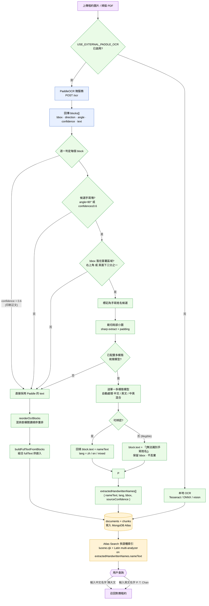

# 多語種手寫姓名識別流程圖

香港租約手寫姓名存在三種場景：**手寫繁體中文**、**手寫英文**、**同一簽名塊中英混合**。
本流程**不部署分開的中文/英文手寫模型** —— PaddleOCR 只做文字區塊檢測，候選手寫塊交由**單一多模態視覺模型**自動處理中/英/混合。

## 流程圖

## 圖例

| 顏色 | 含義 |
| --- | --- |
| 藍色 | PaddleOCR 微服務（只做偵測 + 版面分析，無 DB / 無嵌入 / 無業務邏輯） |
| 綠色 | Node 端邏輯（候選判定 / 裁切 / 多模態調用 / 重排 / 組文） |
| 黃色 | MongoDB Atlas 儲存 + 多語種索引 |
| 紫色 | 起點 / 用戶查詢終點 |

## 責任分界（對應需求 1–6）

| # | 需求 | 對應節點 | 程式碼位置 |
| --- | --- | --- | --- |
| 1 | PaddleOCR 僅做區塊檢測；`confidence>0.6` 印刷正文直接採用 | `E` / `F` | `ocr-service/ocr_service.py`、`src/lib/extract.ts` |
| 2 | 候選判定：`angle≈90°` 或 `confidence≤0.6`，且 bbox 落在右上角/簽署區 | `G` / `H` / `I` | `src/lib/ocrUtils.ts → findHandwrittenNameCandidates` |
| 3 | 裁切局部小圖送**單一**多模態模型，自動處理中/英/混合 | `J` / `L` | `src/lib/handwriting.ts → recognizeHandwrittenNames` |
| 4 | 回填 `block.text` + 頂層 `extractedHandwrittenNames{nameText, lang}` | `N` / `R` | `src/lib/handwriting.ts`、`src/lib/ingest.ts`、`src/lib/mongo.ts` |
| 5 | Atlas Search 多語種索引，中/英名皆可召回 | `U` / `V` / `W` | `atlas-indexes/lexical_index.json`、`scripts/create-indexes.ts`、`src/lib/retrieval.ts` |
| 6 | 無法辨認 → `[無法識別手寫姓名]`，保留 bbox 不丟棄 | `O` | `src/lib/ocrUtils.ts` (`HANDWRITING_ILLEGIBLE`)、`src/lib/handwriting.ts` |

## 啟用條件

- `USE_EXTERNAL_PADDLE_OCR=true` （啟用 PaddleOCR 微服務）
- 配置具備視覺能力的 LLM（`LLM_*` / `OPENAI_*`）
- 重建索引：`npm run reindex`（重建 `lexical_index` 以套用 `extractedHandwrittenNames.nameText` 多語種欄位）

> 若未配置視覺模型，手寫姓名重讀為 no-op，不影響印刷 OCR。
